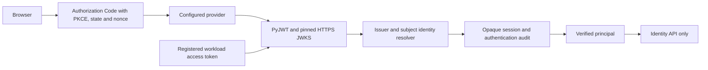

# Centralized authentication and identity

Riswan Platform supports two explicit, separate runtimes. Workstation mode keeps the local investigation workflow. OIDC mode serves identity endpoints and uses a separate SQLite identity database. It never opens the investigation database or derives a tenant from a token or request header. Even authenticated actors receive a denial on tenant-scoped product endpoints until Tasks 4.4–4.5 supply authorization and membership.



## Configuration and provider selection

Amazon Cognito is the provisional managed provider. Its profile validates `token_use`, app client binding, and optional resource-server audience. Generic OIDC requires RFC 9068 access-token typing, explicit API audience, and registered workload client binding. Both profiles use only RS256, exact issuer checks, `kid`, a 5-minute cache and a 5-second refresh cooldown, trusted HTTPS endpoints without redirects, bounded response sizes, verified claim lifetimes and at most 60 seconds of skew. Only the configured keys and endpoints are used. [Amazon Cognito JWT validation](https://docs.aws.amazon.com/cognito/latest/developerguide/amazon-cognito-user-pools-using-tokens-verifying-a-jwt.html) · [JWT access token profile](https://www.rfc-editor.org/rfc/rfc9068)

Install the `identity` extra on a supported Python runtime. Provide an operator-controlled JSON file via `RISWAN_IR_OIDC_CONFIG` and a dedicated SQLite path via `RISWAN_IR_IDENTITY_DB`. Set `RISWAN_IR_MODE=oidc`. The built-in process binds loopback. Use a trusted HTTPS edge in front of it, preserve the configured application Host, and suppress request query strings in proxy access logs. Production infrastructure and certificate provisioning are deferred.

Example for a dedicated test provider:

```json
{
  "provider": "oidc",
  "issuer": "https://issuer.example",
  "jwks_url": "https://issuer.example/jwks",
  "authorization_url": "https://login.example/authorize",
  "token_url": "https://login.example/token",
  "redirect_uri": "https://app.example/v1/auth/callback",
  "client_id": "riswan-browser-client",
  "access_audience": "riswan-identity-api",
  "invited_subjects": ["operator-subject"],
  "privileged_subjects": ["operator-subject"],
  "services": {
    "registered-worker-subject": {
      "client_id": "worker-client",
      "identity_type": "service",
      "required_scopes": ["identity:read"]
    }
  }
}
```

Configure an invite-only user directory, a public browser app client using PKCE, and separate workload clients with narrowly scoped credentials. The provider owns invitations, enrollment, email verification, credential recovery, and passkey availability. The platform additionally gates enrollment on exact configured subjects. MFA is required for all interactive users by default and always required for configured privileged users. Only signed `amr` or explicitly trusted `acr` values count. Before any managed pool rollout, verify its actual claim support, MFA behavior and client configuration. No cloud pool is provisioned by this task. Future agent identity has a reserved type and no authentication path.

For workstation development use `RISWAN_IR_MODE=local` and a development environment without OIDC configuration. Local startup fails when `RISWAN_IR_ENV` is configured for production or another non-development environment, or when an OIDC configuration is present. OIDC cannot select a development provider. The Docker workstation image remains a local-development entry point. Run OIDC verification tests independently of any cloud account.

## Sessions and endpoints

- `GET /v1/auth/login` creates a five-minute browser-bound state and redirects to the provider with PKCE S256 and a nonce. The callback atomically consumes state and verifies the nonce in the signed ID token.
- `GET /v1/auth/callback` issues a new opaque session and invalidates the previous same-actor browser credential when supplied. Session secrets are stored only as SHA-256 digests.
- `GET /v1/identity/me` accepts a valid browser session or a registered workload bearer access token. An ID token cannot authenticate an API request.
- `GET /v1/identity/sessions` and `DELETE /v1/identity/sessions/{id}` are browser-only and scoped to the current actor.
- `POST /v1/auth/logout` revokes the local session and optionally redirects to the configured provider logout endpoint. Provider logout support depends on the provider configuration.
- `POST /v1/auth/refresh` requires a new sign-in. This release discards provider refresh tokens and does not persist them.

Mutating session requests require the configured HTTPS Origin. Cookies are host-only, Secure, HttpOnly, SameSite=Lax, and scoped to `/`. Idle and absolute expiration are checked server-side. Service tokens have a maximum configured lifetime of 15 minutes and must be registered with an exact issuer, subject, client and required scopes. Suspending or disabling an identity revokes its sessions and denies valid bearer credentials. Lifecycle changes are an internal operation. No public administrative endpoint is mounted.

The repository maps issuer and subject to a stable UUID. Email is optional verified profile data. The WSGI layer binds a verified actor separately from `PlatformContext`. Authentication does not grant tenant or product access. A small per-process limiter and bounded login-state store reduce callback and token-verification load. Configure provider and edge protections for production use.

Structured audit rows store event type, UTC time, server-generated request ID, outcome, and verified actor/MFA fields when available. Authorization codes, credentials, token envelopes and refresh tokens are excluded. OIDC-mode WSGI access logging omits request lines to avoid leaking callback query parameters. The SQLite database is a local implementation and has no production retention or managed secret-store guarantees.
