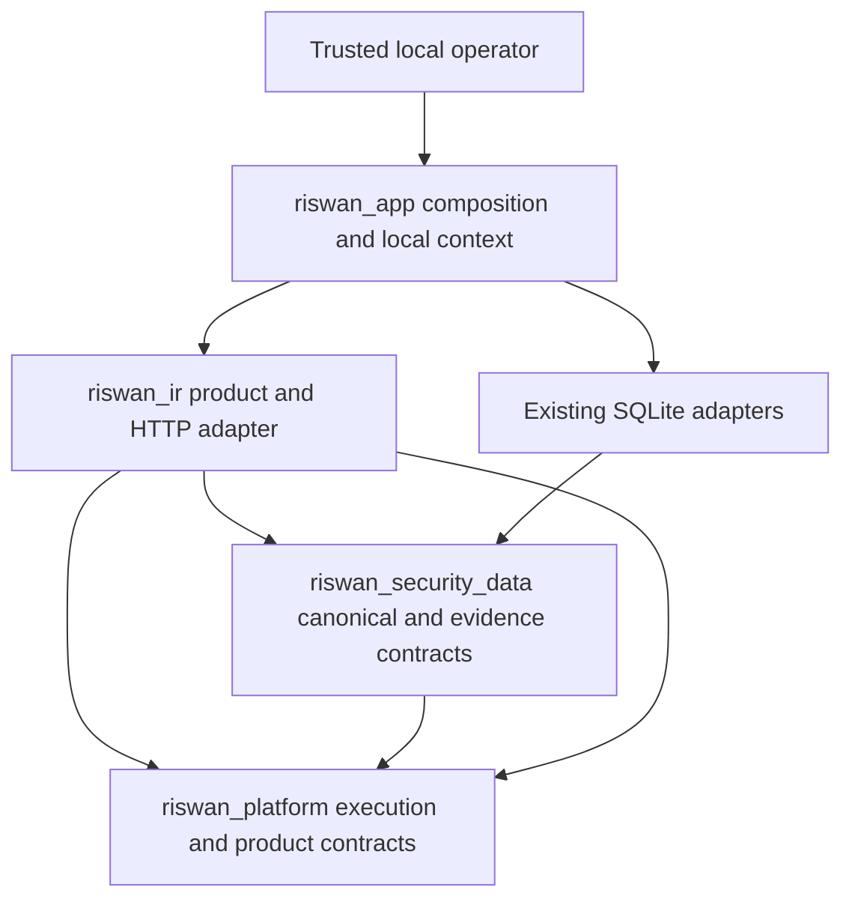

# Platform architecture and product boundaries

Riswan IR remains one installable Python application, backed by the existing local SQLite database. These packages form internal boundaries. Deployment and tenant isolation remain local in this phase.

## Repository inventory and ownership

| Package or adapter | Implemented ownership | Persistence |
| --- | --- | --- |
| `riswan_platform` | Execution context, shared errors, product metadata protocol, and internal notification contracts | Process-local notification deduplication |
| `riswan_security_data` | Canonical events, schema-independent validation, evidence references, provenance, integrity encoding, and published evidence/finding interfaces | Existing `storage/evidence_store.py` owns `raw_evidence`, `raw_evidence_payloads`, `evidence_receipts`, `evidence_transformations` and `evidence_custody` |
| `riswan_app` | Explicit runtime configuration, local provider, SQLite and HTTP composition, and a scoped evidence reader | Opens the one local database |
| `riswan_ir.investigation` | Case lifecycle and product-facing case repository ports | `investigations`, `reviews`, `decisions`, `detection_configuration` owned by the case storage adapter |
| `riswan_ir.detection` and `correlation` | IR detection rules, identity/session attribution, matching and incident timelines | `temporal_correlations` owned by the temporal repository |
| `riswan_ir.knowledge_graph` | Investigation schema, graph construction, queries and provenance | `security_graphs` owned by its repository |
| `riswan_ir.risk` | IR factors, weights, prioritization and reassessment | `risk_assessments` owned by the risk repository |
| `riswan_ir.memory` | Historical classification, recurrence and retrieval | `memory_cases`, `memory_accounts`, `memory_records`, `memory_feedback`, `memory_responses`, `memory_tombstones`, `memory_audit` owned by the memory repository |
| `riswan_ir.connectors` and `ingestion` | IR collection requirements and AWS adapter; collection transaction through a port | `collection_receipts`, `collection_checkpoints`, `collection_status`, `collection_pending` owned by checkpoint storage |

Canonical events remain embedded in archived case reports. Their public model and hash contracts belong to the security-data foundation. Existing table and JSON representations remain compatible. Adapter-level joins and foreign keys within the IR transaction support existing case projections. New domain code consumes data through owner interfaces. The repository does not give future products direct access to IR tables.

## Dependency rules

The shared platform cannot import product, composition, SQLite or security-data internals. Security data may import published platform contracts and cannot depend on IR or the composition layer. IR uses the platform and security-data contracts. Its domain modules do not import SQLite or concrete storage. Product-specific SQLite repositories remain adapters. Only executable entry points use composition from within the IR namespace for launcher compatibility. `tests/architecture` checks dependency direction, cycles, and direct table access from selected domain and collection modules. The required GitHub test job runs the architecture and contract suites on every PR.

## Trusted execution

Set `RISWAN_IR_MODE=local` in a trusted workstation environment to launch through the package or the collector, evidence and detection CLIs. The root `server.py` is an explicit workstation launcher and honors an explicitly set mode. The local composition layer opens a single database and issues a context for its fixed development tenant, with a fresh request and correlation identifier. HTTP headers and JSON cannot establish that context. API operations reject absent or mismatched tenant/product context. Static frontend assets do not require a tenant. CLI operations bind an explicit local service actor. The scope protects the composed boundary. Internal SQLite adapters remain callable by trusted application code and offline tests. This is neither identity proof nor production multi-tenancy.

## Events and cross-product exchange

The dispatcher validates a versioned envelope and binds each publication to the current tenant, product and correlation scope. Event references carry only identifiers. Up to 16 subscribers per event type run synchronously in registration order. Callback failures are recorded without including payload or exception details. The per-process FIFO cache remembers the latest 1,024 event IDs per dispatcher, across scoped deliveries. No retry, recursive dispatch, restart recovery or durable delivery is provided.

The HTTP investigation adapter emits `ir.investigation.created` after committing a new case or revision. The remaining initial taxonomy is reserved in `riswan_platform.events.TAXONOMY`. Evidence, custody, risk and memory persistence remain transactional. Durable asynchronous consumers should use a transactional outbox in a later task.

A future authorized integration can exchange `SecurityFinding` values with explicit tenant, producing product, schema version and evidence references via the published receiving port. A consumer must verify access to referenced evidence in its active context. The current dispatcher does not route across tenants or products. The contract avoids access to another product’s tables.

## Planned capabilities

| Task | Planned shared owner |
| --- | --- |
| 4.3–4.7 | Identity and authentication, RBAC, tenancy, secrets, encryption and data isolation |
| 4.8–4.11 | API infrastructure, shared navigation, connector lifecycle and product availability |
| 4.12–4.13 | Deployment infrastructure and observability |

Investigation policies, graph relationships, risk weights, threat hunting, incident response playbooks and future autonomous investigation remain product-specific. Reusable scoring, graph, memory, and connector interfaces should be extracted with a demonstrated consumer. FastAPI, PostgreSQL, Alembic, object storage, an OIDC provider, a shared frontend, Terraform and OpenTelemetry are later decisions. No network, broker, or deployment changes are required for these boundaries.
