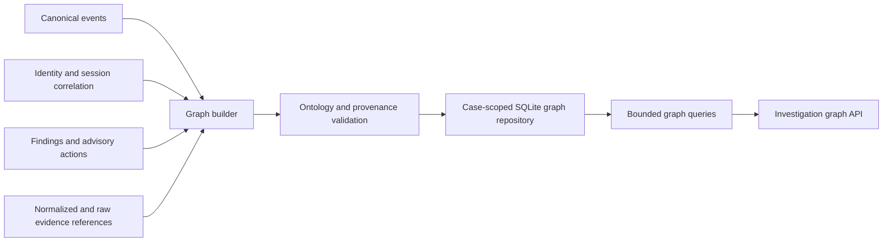

# Security knowledge graph

SentinelForge builds a case-scoped graph after canonical event mapping, identity and session correlation, detection, and evidence transformation. The versioned ontology defines allowable directional relationships among identities, sessions, resources, accounts, networks, events, permissions, findings, threats, evidence, investigations, and advisory actions.

Provider-specific resolvers use account, partition, provider, and stable source identifiers. Regional resource names also use region where available. Local nodes such as events, evidence, and findings use a case namespace. Names with insufficient scope stay event-local. Repeated observations of the same supported relationship add provenance instead of creating duplicate edges.

The builder records every edge's event ID, normalized evidence reference, observation time, source, and correlation confidence where provided. A normalized evidence node links to its retained raw evidence identifier when custody metadata supplies one. Legacy evidence falls back to its event identifier. Evidence retention may remove a raw payload while keeping its provenance identifier.

Role and session issuance edges come from correlation results. Activity edges use canonical event and explicitly observed resource data. Successful read and known mutation operations can yield stronger edges. Failed calls may still target a resource. Permission edges record successful attachment to the explicitly named user or role. They do not represent current effective access. Resource ownership requires an explicit account or an owner-bearing ARN. A recipient account may provide identifier scope without asserting ownership.

The SQLite adapter saves a validated snapshot in the same transaction as the investigation. Approved and rejected action status updates are atomic with the analyst decision. Older investigations are projected on read from their archived data. They may expose fewer relationships because historical exports lack canonical attributes or custody references. The existing `/graph` response is preserved.

## API

All paths are relative to `/v1/investigations/{case_id}/knowledge-graph`.

| Request | Result |
| --- | --- |
| `GET /` (omit the trailing slash) | Paginated nodes and relationships. Filter with `kind`, `relation`, `account`, `partition`, `limit`, or `offset`. |
| `GET /ontology` | Ontology version and allowable directional endpoint kinds. |
| `GET /nodes/{node_id}` | Exact node lookup in the selected case. |
| `GET /relationships` | Relationship page. Filter by `source`, `target`, or `relation`. |
| `GET /relationships/{edge_id}` | Relationship and supporting evidence metadata. |
| `GET /traverse?node={node_id}&depth=2&direction=both` | Breadth-first traversal. Repeat `relations` for a bounded relationship allowlist. |

To find identities that accessed a resource, start at its node and traverse both directions across `ACCESSED_RESOURCE` and `AUTHENTICATED_AS` at depth two. To find related findings, follow `TARGETED` and `SUPPORTED_BY` up to three hops through event and evidence nodes. These paths describe supported relationships and still require analyst judgment. To list involved accounts, query `?kind=account`.

Lists are capped at 200 entries per collection. Traversal is capped at four hops and up to 200 nodes and relationships, with a truncation flag. A query with `account` returns only entities and observations in that account and partition, excluding cross-account edges. A case-wide view can include evidenced cross-account links. These are structural query boundaries in the local single-operator model. They are not tenant authentication or authorization.

The graph does not create inferred links from timestamp proximity, model effective IAM policy, or execute advisory actions. The current builder consumes AWS CloudTrail; the ontology and repository interface can support other providers over time.
