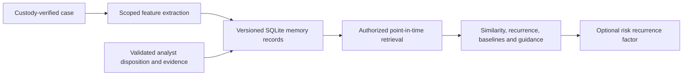

# Historical investigation memory

SentinelForge indexes a minimized, versioned profile after case custody verification. The profile is derived from canonical events, attributed identities and sessions, the knowledge graph, and temporal incident evidence. Historical profiles become retrieval candidates after analyst review. A match supplies leads and evidence references for analyst review.

## Memory categories

| Category | Stored or approved context |
| --- | --- |
| Episodic | Investigation and lineage identifiers, scope, and evidence references. |
| Semantic | Ordered activity signals, rule and ATT&CK matches, graph relationship shapes, and pattern evidence. |
| Behavioral | Event operations, UTC time buckets, and scoped pseudonymous identity, session, resource, network and service indicators. |
| Analyst feedback | Evidence-linked classifications and recorded times. Reviewer notes stay in the case report. |
| Response | Evidence-backed containment observations accepted by risk assessment and analyst feedback. |
| Organizational | Derived environment tags. Source inventory remains under local operator control. |
| Procedural | Approved text guidance from the local versioned policy. |

Memory never ingests credential IDs or raw payloads. Scope-bound hashes reduce exposure of identity and network labels. They are pseudonymous and should receive the same workstation protections as the database. Profiles and feedback store integrity digests. Local privileged database writers remain inside the workstation trust boundary.

## Similarity, recurrence, and baselines

Similarity uses weighted Jaccard overlap across attack patterns and event sequences (25%), identity and privilege (20%), ATT&CK techniques (15%), graph relationships (15%), resource characteristics (10%), detection rules (10%), and environment (5%). The score includes no weight for unavailable factors. The default minimum comparable weight is 60%. The response explains available and missing factors. Scores describe resemblance.

Recurrence examines shared rule, activity, misconfiguration, resource, control and telemetry gap patterns. A rule contributes 25 risk points per prior confirmed case, capped at 100, once at least two authorized independent cases support the rule. This value goes into the existing weighted recurrence factor. Explicit risk inventory entries take precedence. Duplicate raw event references and shared case lineages cannot add independent votes. Historical memory does not change confidence or count as independent corroborating evidence. Risk replay keeps the previously archived factor value and policy digest after memory retention or deletion.

Behavioral baselines use only evidence explicitly cited by authorized-activity feedback and earlier than the case's first occurrence. For each scoped group, they track operations, resources, authentication, network, UTC hour and daily activity. At least the configured sample minimum and two observed days are needed. Where sufficient, weekday or weekend observations are compared separately. Drift compares the earlier and later median observed-day frequency. Rates are conditional on days with retained observations. Anomaly signals have no automatic effect on detection or risk policy.

## Policy and governance

Set `SENTINELFORGE_MEMORY_POLICY` to a trusted local JSON file. Supported properties include `version`, `observation_days`, `retention_days`, `category_retention`, `enabled_categories`, `minimum_samples`, `minimum_coverage`, `organization_accounts`, and `playbooks`. Defaults are a 90-day observation window, 180-day retention and three observations per baseline. Complete account scope is required. By default a query can retrieve only its own account. To authorize a group explicitly, set `organization_accounts` to a list of disjoint lists of partition-qualified account IDs such as `["aws:111122223333", "aws:444455556666"]`.

Retrieval applies both archived policy and current authorization. Unknown or contradictory account attribution fails closed. Outcome classifications are recorded from analyst dispositions. Authorized activity and false positives require a benign disposition and same-case evidence. Confirmed threat requires confirmed disposition. Response memory requires an evidence-linked residual-risk assessment. Feedback never edits detection rules, suppresses alerts, or changes a scoring policy.

The repository audits indexing, retrieval, feedback, response evidence changes and deletion as case identifiers, timestamps, policy or result digests, and action labels. Category expiration prunes derived memory. Deleting a case profile removes its memory records and leaves a tombstone to prevent automatic reindexing. Original evidence, analyst reviews and risk assessments remain under their existing lifecycle. Point-in-time retrieval reproduces the retained corpus and filters out later reviews. Expiration, deletion and authorization revocation take precedence over historical access.

## API

The case routes are relative to `/v1/investigations/{case_id}`.

| Request | Purpose |
| --- | --- |
| `GET /memory?as_of=UTC_TIMESTAMP` | Retrieve scoped historical intelligence and provenance. Omit the query to use the present. |
| `POST /memory/index` | Index an existing case with valid retained custody. Older cases can also be indexed on the next analyst review. |
| `POST /memory/feedback` | Submit `classification` and same-case normalized `evidence_references`. |
| `DELETE /memory` | Delete the derived case profile and block reindexing. |
| `POST /v1/memory/expire` | Purge expired records across categories. |

The app limits retrieval to 100 scoped candidate cases, ten matches, 25 patterns and 24 activity profiles. Isolation relies on the existing local single-operator boundary and the configured account policies. The service is intended for a trusted operator.
