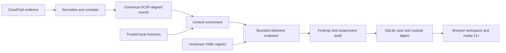

# Context-aware detection

SentinelForge evaluates canonical OCSF-aligned events once identity correlation has selected evidence for a case. The AWS mapper adds typed identity metadata and bounded CloudTrail signals for resource identifiers and policy, ingress, and snapshot observations. The engine joins these signals with local inventory for privileged roles, sensitive resources, accounts, approved networks, and known relationships. An earlier successful role assumption in the same investigation also establishes that relationship for later events.



The original triage score and claim IDs remain available in `assessment`. Contextual findings, rule versions, metrics, and exception or suppression decisions appear in the optional `detection` report field and the browser workspace. Each new finding identifies its rule and version, condition evidence, supporting event IDs, severity, and an advisory recommendation. Suppression retains evidence and records why an additional finding did not appear.

The application saves the rule definitions and inventory used by each investigation in SQLite in the same transaction as the report. The custody entry seals the detection result, including its configuration fingerprint. Execution logs emit counters and the fingerprint when INFO logging is enabled. The application does not include the full operator inventory in its HTTP response or logs.

## Local configuration and replay

Set `SENTINELFORGE_DETECTION_CONTEXT` to a trusted local JSON file and optionally set `SENTINELFORGE_DETECTION_RULES` to a trusted replacement YAML registry. Reload the process after changing configuration. An empty inventory leaves context-dependent conditions unknown. See [rule authoring](rule-authoring.md) for a configuration example and rule semantics.

```powershell
sentinelforge-detect CASE_ID --db sentinelforge.sqlite3
sentinelforge-detect CASE_ID --db sentinelforge.sqlite3 --version SF-AWS-DEF-001=1.0.0
sentinelforge-detect CASE_ID --db sentinelforge.sqlite3 --rules reviewed-rules.yml
```

Replay reads the supplied case, verifies its custody, and uses the case's archived context. The default verifies that the current evaluator reproduces the archived result. Explicit selections may use archived versions, versions in the current registry, or versions in the supplied replacement file. Older cases with valid custody use their existing canonical events or a legacy projection and empty inventory. Older canonical archives may lack newer detection signals. Replay does not rewrite the stored investigation.

History is scoped to correlated evidence in the selected case and the operator-supplied relationship inventory. An unseen relationship requires a configured baseline for that actor. A public policy finding identifies an unconditional wildcard grant in the request, while effective access also depends on bucket and account controls. Network context uses configured CIDRs, not IP reputation.
