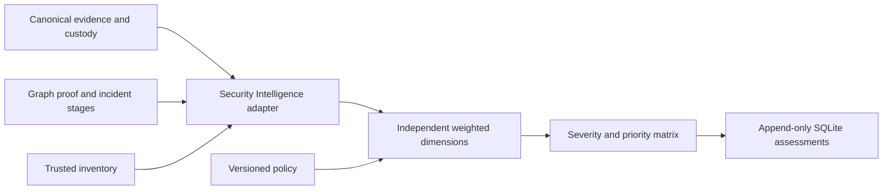

# Risk and confidence scoring

Riswan IR creates assessments for contextual findings and temporal incidents. The legacy investigation triage score remains in its existing report field. Security Intelligence projects canonical events, custody verification, graph proof, detection context and curated inventory into observations. The weighted engine accepts provider-neutral factors and can be reused with a different product adapter.

Each dimension divides the sum of value times weight by the sum of weights with observed or estimated values. Unknown observations contribute no points or weight. A dimension with no usable input returns a null score. The response includes assessed weight, every configured contribution, evidence references, observation status, and missing factors. Thresholds use exact rational arithmetic. A narrow assessment can receive a high score, so review its assessed weight and missing factors alongside it.

## Default Security Intelligence policy

| Risk factor | Weight | Criteria |
| --- | ---: | --- |
| Potential threat impact | 25% | Rule-declared impact maps to 10, 25, 55, 80, or 100. |
| Asset criticality | 20% | The highest applicable standard, sensitive, or critical asset maps to 25, 80, or 100. |
| Identity privilege | 15% | Root use, explicit actor privilege, or a known privileged or non-privileged role. |
| Resource exposure | 10% | Direct public-policy signal or scoped local inventory. |
| Attack progression | 15% | Twenty points per distinct supported incident stage, capped at 100. |
| Business impact | 10% | An independent operator estimate of operational or data consequences. |
| Historical recurrence | 5% | Optional operator-provided rule recurrence indicator. |

| Confidence factor | Weight | Criteria |
| --- | ---: | --- |
| Evidence integrity and provenance | 20% | Conflicted custody scores 0. Verified custody with expired raw evidence scores 50, retained evidence scores 75, and independently authenticated source metadata can reach 100. |
| Correlation reliability | 25% | The weakest attributed identity or session observation used in the supporting proof. |
| Rule reliability | 20% | Optional operator judgment about the rule. |
| Independent corroboration | 20% | An event independently corroborated by distinct authenticated provider/service sources. Repeated copies of CloudTrail are one source. |
| Telemetry completeness | 15% | Availability of evidence references, actor, account, and outcome across the supporting observations. |

These are initial engineering assumptions. Confidence indicates evidence strength. It is not a calibrated probability. Hash verification demonstrates consistency with archived content. It does not attest to the identity of the original source. Asset criticality and business impact describe distinct concepts and require independent inputs. The adapter uses the strongest applicable inventory estimate per factor. It does not sum repeated appearances of the same asset, role, or rule.

| Exact risk interval | Severity | Default priority |
| --- | --- | --- |
| 90 through 100 | Critical | P0 with strong evidence, P1 if confidence is low, missing, or conflict is present |
| 70 up to 90 | High | P1 |
| 40 up to 70 | Medium | P2 |
| 20 up to 40 | Low | P3 |
| Below 20 | Informational | P4 |

An unknown risk score receives P2 for review. A benign analyst disposition records dismissal at P4 while preserving the assessed risk and confidence values. A confirmed disposition records analyst validation independently of evidence integrity. Containment changes priority using residual risk when qualifying evidence is available.

Set `RISWAN_IR_RISK_POLICY` to a trusted local YAML list containing versioned scoring policies. The newest Security Intelligence policy is selected by numeric version. Each dimension must total 100. Change the version when editing weights or thresholds. `RISWAN_IR_RISK_INVENTORY` accepts a trusted local JSON document with `asset_criticality`, `identity_privilege`, `resource_exposure`, `business_impact`, `historical_recurrence`, and `rule_reliability` maps. Qualify resource keys with `ACCOUNT/RESOURCE` for scoped estimates. Inventory values and file paths are never accepted in the HTTP request. The archived evaluation stores the resulting factor inputs and exact policy with each assessment.

## Reassessment and replay

New cases and evidence revisions create assessments. Analyst review and on-demand reassessment append a record when inputs or policy change. Previous assessments remain queryable with their original policy. A revision of the same stable finding or incident inherits the original assessment reference. Older cases can be assessed on demand when they have a supported subject.

The initial containment adapter recognizes successful removal of an observed unconditional public S3 bucket policy on the same scoped resource, after the supporting events. It requires intact case custody and retained raw evidence. A subsequent public grant invalidates the reduction. Only the affected exposure factor is reduced, and explicitly configured exposure remains a floor. The original and current potential risk scores stay separate from residual risk.

All paths are relative to `/v1/investigations/{case_id}`.

| Request | Result |
| --- | --- |
| `GET /risk` | Latest assessment per case subject, with `limit` and `offset`. |
| `GET /risk/{assessment_id}` | Read an immutable assessment. |
| `GET /risk/{assessment_id}/replay` | Recompute from archived factors and policy. |
| `GET /risk/{kind}/{subject_id}/history` | Paginated history scoped to this case revision. |
| `POST /risk/reassess` | Reassess a finding or incident by `subject_kind` and `subject_id`. Optionally provide the same case's normalized `containment_evidence_id`. |

The API uses the existing local single-operator boundary and case-scoped lookups. It does not add tenant authentication. Evaluation tests exercise reference arithmetic, factor sensitivity, unrounded thresholds, policy changes, contradictory evidence, containment, and replay. The [benchmark](../../tests/performance/test_risk_performance.py) measures 1,000 weighted assessments independently of SQLite and enrichment.
