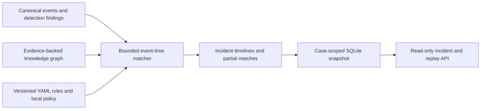

# Temporal threat correlation

SentinelForge builds possible incidents from correlated CloudTrail observations in one investigation revision. Canonical events supply operation, provider, identity and resource attributes. The security graph supplies evidence for the identity, session, resource, and credential-lineage joins. Context and existing detection findings can qualify a stage. Time proximity alone cannot join events.



The matcher processes UTC occurrence time and uses event IDs to make input ordering deterministic. Strictly ordered stages cannot share the same timestamp. The engine preserves the first receipt time separately and never silently adjusts a timestamp to force a match. A late event supplied through the existing revision endpoint can change or complete a match when its occurrence time and links satisfy the rule. Previously stored revisions remain queryable.

## Trusted policy and rules

The bundled [rule catalog](../../src/sentinelforge/correlation/temporal/aws-rules.yml) is a safely parsed YAML list. A rule declares `id`, `name`, `version`, `window_minutes`, `group_by`, `stages`, `severity`, and `recommendation`. It can specify a minimum stage count, enablement, suppression duration, ATT&CK mappings, and cross-account eligibility. A stage specifies AWS service, allowed operations, outcomes, required predicates and optional finding-rule IDs. Stage counts require distinct matching events. Optional interior stages may be omitted. A `requires_chain` stage needs a directed evidence-backed credential transition. Rule versions are immutable once published.

`SENTINELFORGE_TEMPORAL_RULES` can point to a trusted replacement YAML file. `SENTINELFORGE_TEMPORAL_POLICY` can point to a trusted JSON file. A policy may use the detection inventory schema under `enrichment`. When that property is omitted, it inherits the locally configured detection inventory. The same schema supports time-limited rule exclusions scoped to matching attributes. Cross-account transitions are disabled by default. For example:

```json
{
  "cross_account": [
    {"source": "aws:111122223333", "target": "aws:444455556666"}
  ]
}
```

Both a cross-account-enabled rule and an applicable directed policy entry are needed. The matching requires positively attributed graph relationships and never queries another case. The local single-operator API does not authenticate tenants.

Identity grouping requires the same attributed identity, session grouping requires the same session, and lineage grouping accepts the same session or a bounded credential-use path. Resource grouping additionally requires a shared scoped resource and the same session. Unattributed events may still appear in evidence and fail the relevant incident stage. A match retains evidence references, supporting finding IDs and graph relationship references. Potential incidents remain advisory.

## API and replay

All endpoints are read-only and relative to `/v1/investigations/{case_id}`.

| Endpoint | Use |
| --- | --- |
| `/incidents` | List incident candidates and timelines. |
| `/incidents/{incident_id}` | Read one incident, severity, rules and evidence references. |
| `/incidents/{incident_id}/timeline` | Read chronological stages and provenance. |
| `/temporal-correlation` | Read rule versions, partial matches and execution counters. |
| `/temporal-correlation/replay` | Verify custody and reproduce the stored result. Repeat `version=RULE_ID=VERSION` to select archived versions. |

The repository atomically stores partial and completed matches with the investigation, rules and local policy. It recomputes from case evidence during revisions so out-of-order and late occurrences can produce deterministic results. Identical records are deduplicated by normalization. Incidents have stable IDs within a case lineage for the same rule version, group, and starting event. Suppression prevents multiple nearby completions in that group from inflating the candidate list. Distinct rule scenarios can report the same evidence when they describe different hypotheses.

The engine inherits the 2,000-event case limit, accepts up to 100 rule versions per file, and caps live states at 128 per rule. Resource-based starters consider up to eight scoped resources per event. It limits credential traversal to three hops and 64 inspected graph edges per check. It also bounds graph checks, retained partials, and reported incidents. Inspect `truncated_states` when reviewing noisy cases. Logged counters exclude event details and configuration data.

Run the benchmark with:

```bash
python -m pytest tests/performance/test_temporal_performance.py -v --junitxml=temporal-benchmark.xml -o junit_family=xunit1
```

The benchmark measures the temporal matcher with 2,000 prebuilt events and graph observations. It records latency and events per second independently of ingestion and SQLite.

See the [scenario prerequisites and false positives](temporal-rule-catalog.md).
